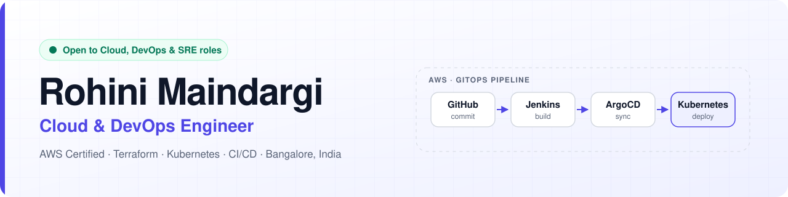

<picture>
  <source media="(prefers-color-scheme: dark)" srcset="assets/banner-dark.svg">
  
</picture>

  
  
  
  

## 👩‍💻 About me

I build **secure, automated and highly available infrastructure on AWS**, from Terraform and CI/CD pipelines to Kubernetes and GitOps.

- 💼 **Cloud Engineer at Genpact**, 3+ years in cloud & DevOps
- ☁️ **AWS Certified**: Solutions Architect – Associate and Cloud Practitioner
- 🎯 I care about infrastructure that is **secure by default, repeatable and easy to recover**
- 📍 Bangalore, India · 🟢 **Open to Cloud, DevOps & SRE roles**

## 🛠️ Tech stack

  

  
  
  
  
  
  

## 🚀 Featured projects

<table>
  <tr>
    <td width="33%" valign="top">
      <h3>🔁 GitOps CI/CD Pipeline</h3>
      GitHub → Jenkins (Maven build &amp; test) → Docker image → ArgoCD → Kubernetes. Every commit reaches a running app automatically, with easy rollbacks.
        
      <b>Jenkins · Docker · Kubernetes · ArgoCD</b>
    </td>
    <td width="33%" valign="top">
      <h3>🌍 Multi-Region HA App</h3>
      Route 53 health checks and failover across two AWS regions, each with an ALB and EC2 Auto Scaling, plus cross-region RDS replication.
        
      <b>Route 53 · ALB · Auto Scaling · RDS</b>
    </td>
    <td width="33%" valign="top">
      <h3>🏗️ Infrastructure as Code</h3>
      Reusable Terraform modules and CloudFormation templates for VPC, EC2, RDS and IAM, with dev / staging / prod environments and remote state.
        
      <b>Terraform · CloudFormation · AWS</b>
    </td>
  </tr>
</table>

📐 <b>Architecture diagrams for each project: <a href="https://rohini-maindargi.github.io/#projects">rohini-maindargi.github.io</a></b>

## 📜 Certifications

  
  

  
  

## 💼 Experience

| Role | Company | When |
| :-- | :-- | :-- |
| **Cloud Engineer** | Genpact | 2023 – Present |
| **Cloud Technical Support Intern** | Concentrix | 2022 – 2023 |

🎓 **B.Tech, Electronics & Communication Engineering**, Central University of Karnataka

---

  💬 Hiring for Cloud, DevOps or SRE? Reach me at <a href="mailto:rohinimaindargi@gmail.com">rohinimaindargi@gmail.com</a> or on <a href="https://www.linkedin.com/in/rohini-maindargi">LinkedIn</a>.

